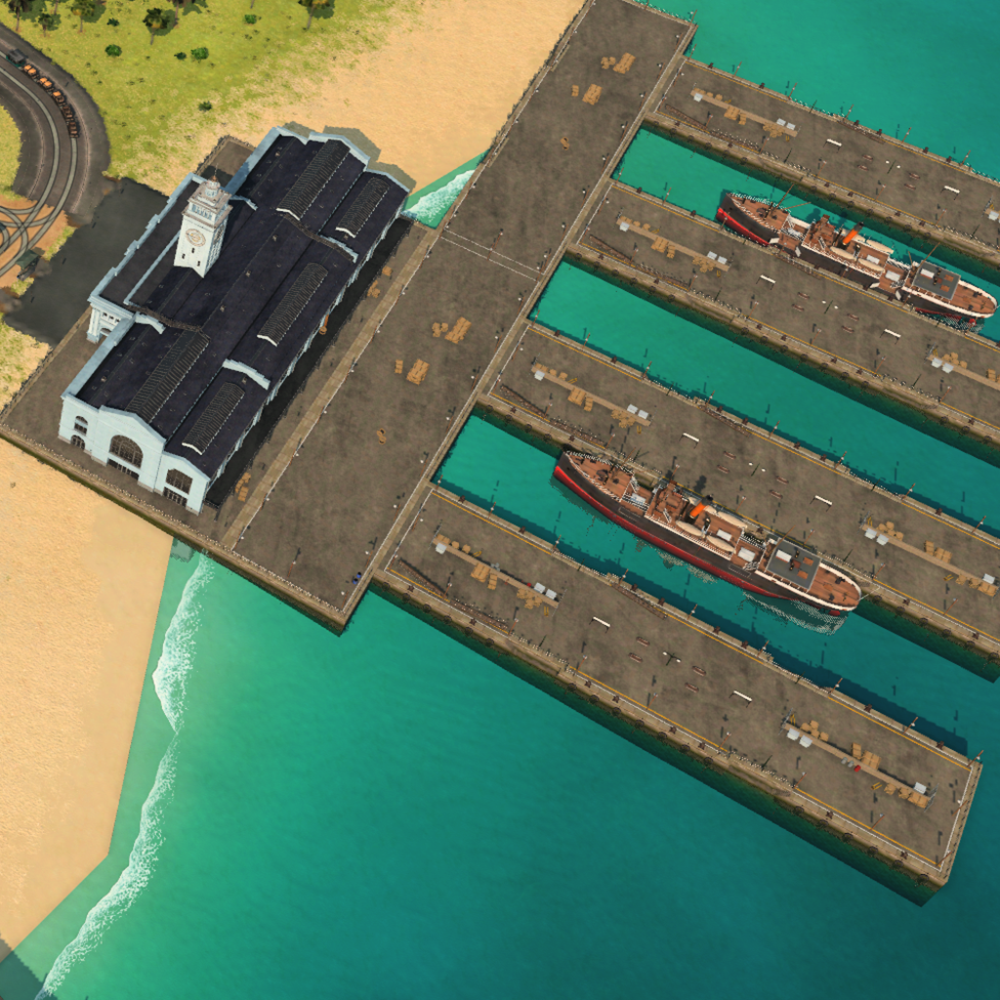

# TF3-DRPC: Discord Rich Presence for Transport Fever 3



Show what you're doing in **Transport Fever 3** in your Discord status: your company's rank,
the in-game date, the game mode, whether the game is paused, and how long you've been
playing. If you like, your network, your money or your savegame's name too.

```
Transport Fever 3
Mechanic
September 1905
01:23:45 elapsed
```


## What Discord shows

| When | Your status |
|---|---|
| The game is starting | "Starting the game" |
| In the main menu | "In the main menu" |
| Loading a game | "Loading..." |
| Playing | your rank and the in-game date, for example "Mechanic" and "September 1905" |
| Paused (pause button or game menu) | the same, with " · Paused" added |
| Tycoon mode, Sandbox mode or the map editor | the mode next to your rank, for example "Junior · Map Editor" |
| A campaign mission | "Campaign" and the mission's name |
| Playing a savegame without the mod | "Playing" |
| The game is closed | nothing; the status disappears |

The timer counts from when you started the game, and starts again when you load a savegame.
Discord accepts a new status at most every 15 seconds, so a change can take that long to
show.

## Requirements

- **Transport Fever 3** on Steam.
- The **Discord desktop app**, running and logged in. The browser version of Discord can't
  receive a status from other programs. Discord's activity privacy settings must allow
  sharing your activity.
- **Windows 10 (version 2004) or later**, or **macOS 26 or later** on a Mac with Apple
  silicon. The macOS app is experimental; see [below](#macos-experimental).

## Installation

### 1. Get the mod

Subscribe to **Discord Rich Presence** in the game's **Mod Hub** (main menu → "Mod Hub").

### 2. Turn the mod on for your game

Transport Fever 3 turns mods on per game, so do this once for each savegame:

- **An existing savegame:** in "Load Game", click the gear button next to the savegame, open
  the **Mods** tab, click **Activate** on "Discord Rich Presence", then load the game. **Save
  once** right away, otherwise the mod is only on for this one session.
- **A new game:** in the new game's settings, open the **Mods** tab and activate "Discord Rich
  Presence" before you start.
- **The map editor:** the same, under "Add mods" in the map's gear dialogue.

Campaign missions always start with only their own mods, so the mod doesn't run there. The
app still shows that you're playing the mission.

### 3. Get the companion app

1. Download the zip for your system from the [Releases](../../releases) page:
   `TF3-DRPC-<version>-windows-x64.zip` or `TF3-DRPC-<version>-macos-arm64.zip`.
2. Extract it to any folder you like, for example `Documents\TF3-DRPC`. Don't use
   `Program Files`, because the app saves its settings next to itself.
3. Start it:
   - **Windows:** `TF3-DRPC.exe`. The first start shows a SmartScreen warning; see
     [Windows: the SmartScreen warning](#windows-the-smartscreen-warning) below.
   - **macOS:** see [macOS (experimental)](#macos-experimental) below.

The app needs no installation and starts no other programs; only the **GitHub** and **mod.io**
buttons in its settings window open your browser. Start it whenever you want to
play, before or after the game.

### Windows: the SmartScreen warning

> [!NOTE]
> The app isn't code-signed yet, so Windows doesn't know who made it and shows
> **"Windows protected your PC"** (Microsoft Defender SmartScreen) when you start it. Only
> continue with a download from this repository's [Releases](../../releases) page.

1. Click **More info**.
2. Check that the app is `TF3-DRPC.exe`, then click **Run anyway**.

To avoid the warning, right-click the downloaded zip before you extract it, choose
**Properties**, tick **Unblock** and click **OK**.

### macOS (experimental)

> [!WARNING]
> The macOS app is experimental. It works in our tests, but it has had far less use than the
> Windows app, so expect rough edges and please [report problems](../../issues).
>
> The app isn't signed or notarised by Apple yet, so macOS blocks it the first time. You have
> to allow it once by hand, as described below. Only do this with a download from this
> repository's [Releases](../../releases) page.

1. Make a folder of its own for the app, for example `TF3-DRPC` in your Documents folder,
   and move `TF3-DRPC.app` there with Finder. The app keeps its settings in a `DATA` folder
   next to itself, so don't put it straight into Applications: that would leave a `DATA`
   folder in Applications, and without an administrator account the app can't write there.
   If you start the app in the Downloads folder, macOS runs it from a hidden temporary copy,
   and the app's window asks you to move it.
2. Open the app. macOS says it can't verify the app and doesn't open it; click **Done**.
3. Open **System Settings → Privacy & Security**, scroll down to the message about
   TF3-DRPC, and click **Open Anyway**. Confirm with your password or Touch ID.
4. Open the app again and confirm **Open**. From then on it starts normally.

If you prefer the Terminal, `xattr -dr com.apple.quarantine ~/Documents/TF3-DRPC/TF3-DRPC.app`
does the same as steps 2 and 3 (adjust the path if you put the app elsewhere).

## Using the app

The app lives in the **tray** (Windows, next to the clock; right-click the icon) or the
**menu bar** (macOS; click the icon). Its menu has:

- **Language:** the language of your status and of the app; "Same as the game" by default.
- **Settings…** opens the settings window. On Windows a double-click on the icon does the
  same.
- **Exit** closes the app and clears your Discord status.

Closing the settings window keeps the app running. Starting the app a second time just opens
the settings window of the one already running.

### Settings

The top of the window shows what the app sees (the game's state, the game's build while the
game runs, and whether Discord is connected) and a **preview** of your status. Below that:

- **Theme:** "Same as the system", "Light mode" or "Dark mode" for the settings window.
- **Language:** "Same as the game", or one of the 13 game languages: Deutsch, English,
  Español, Français, Italiano, 日本語, 한국어, Nederlands, Polski, Português (Brasil),
  Русский, 简体中文 and 繁體中文.
- **Status appearance:** how your status looks. Hover over an entry to see what it would
  show right now.

  | Preset | Example |
  |---|---|
  | Career (default) | "Mechanic" / "September 1905" |
  | Network | "Lines 44 · Vehicles 118" / "Stations 74 · 1905" |
  | Era | "Year 1905 · Tropical" / "Mechanic" |
  | Alternating | Career, Network and Era in turn, about every 45 seconds |
  | Minimal | "In game · 1905" |
  | Custom | your own first line, second line and image tooltip |

- **Show a button to the Steam store:** adds a "Get Transport Fever 3" button below your
  status. Others see it; Discord doesn't show it to you. It is off by default.

At the bottom, next to **Exit**, the **GitHub** button opens this repository and the **mod.io**
button the mod's page in your browser.

### Your own status text

Choose **Custom** to write the two lines and the tooltip of the cover image yourself. Use
placeholders in curly braces; the window lists them all with an explanation:

| Placeholder | Shows |
|---|---|
| `{rank}` | your company's rank, as in the game bar |
| `{mode}` | "Tycoon", "Sandbox Mode" or "Map Editor"; nothing in a normal game |
| `{date}`, `{month}`, `{year}` | the in-game date |
| `{climate}` | the map's climate |
| `{lines}`, `{stations}`, `{trains}`, `{vehicles}` | your network |
| `{passengers}`, `{cargo}` | passengers and cargo transported so far |
| `{companyValue}` 🔒 | your company's value |
| `{balance}` 🔒 | your money |
| `{saveName}` 🔒 | your savegame's name ("New Game" before the first save) |

Separate parts with `·`; a part whose placeholder has no value is left out. For example,
`{rank} · {balance}` shows "Mechanic · $25M". Your text is saved a second after you stop
typing.

> [!IMPORTANT]
> Placeholders marked 🔒 show personal information. Everyone who can see your Discord status
> sees them too.

## Troubleshooting

| Problem | What to do |
|---|---|
| "Windows protected your PC" when starting the app | The app isn't code-signed yet. Click **More info**, then **Run anyway** (see [the SmartScreen warning](#windows-the-smartscreen-warning)). |
| Discord shows nothing at all | Make sure the Discord desktop app is running and logged in, and that its activity privacy settings allow sharing your activity. The app's settings window says whether it is connected to Discord. |
| Discord shows "Playing", but no rank or date | The mod isn't on in this savegame. Turn it on in the savegame's gear dialogue and save once (see [step 2](#2-turn-the-mod-on-for-your-game)). |
| The status says "Paused" although the game runs | The game menu (Escape) was open. The status goes back to normal within about 30 seconds after you close it. |
| "In the main menu" while a new map is being created | The game doesn't report this step; the status changes once the map is ready. |
| The app says it can't save its settings | Move the app's folder to a place you can write to, for example your Documents folder. |
| A change doesn't show up at once | Discord accepts a new status at most every 15 seconds. |
| Discord shows only "Playing", and the app's log says "The game's files were not found yet" | The app found the game but not its log file in Steam's user data folder. It keeps looking every 15 seconds and writes this line once. If it stays like this, [open a bug report](../../issues/new/choose) with the log. |

If none of this helps, [open a bug report](../../issues/new/choose). It asks for the app and
game versions and the app's log from the `DATA/logs` folder.

## Uninstalling

Exit the app and delete its folder, which holds the app and its `DATA` folder.
On macOS, also delete the two files the system wrote (see [Privacy](#privacy)) if you want
nothing left behind. Unsubscribe from the mod in the Mod Hub.

## How it works

TF3-DRPC has two parts, and you need both:

- **The mod** runs inside the game. Every 10 seconds it writes the game state (date, rank,
  mode, network and money) as one line to the game's log file. It changes nothing in your
  game, and achievements stay available.
- **The companion app** runs next to the game, in the Windows tray or the macOS menu bar. It
  reads those lines and shows them in Discord.

They have to be separate because a Transport Fever 3 mod can't talk to other programs such
as Discord, and mods may not contain programs of their own.

## Made with AI

Yes, this project was built with AI, namely Claude by Anthropic, working in Claude Code: the
mod, the app, the tests and the very text you're reading. Claude wrote the code and never
once got to play the game. A human decided what to build, tested it in the game and said "no,
not like that" a great many times. That human also knows their way around C# and reviewed
the code, so it wasn't waved through unread. If that bothers you, that's fine; nobody is
making you put your rank in your Discord status. Everyone else: enjoy the trains.

## Privacy

- The app sends your status only to the Discord app on your own computer, which shows it to
  others like any other game activity. Nothing else leaves your computer, and there is no
  telemetry.
- By default your status shows only your rank, the date and the game mode. Your money, your
  company's value and your savegame's name appear only if you add them to a custom status.
- The app reads the game's log file and language setting. It writes only to the `DATA`
  folder next to itself: your settings (`settings.json`) and a log of the last 7 days
  (`logs/`). It changes nothing in the registry or your user folders, and doesn't start with
  your computer. On macOS the system itself also writes two small files the app can't
  prevent: the window's position in `~/Library/Preferences/com.zagrthos.tf3drpc.plist` and
  `~/Library/Saved Application State/com.zagrthos.tf3drpc~iosmac.savedState`.

## Why the app is so big

| | Download | Extracted |
|---|---|---|
| Windows | about 33 MB | about 83 MB |
| macOS | about 10 MB | about 21 MB |

The Mac app is much smaller because macOS already includes the frameworks that draw the
window and the menu bar menu, so the app uses those instead of bringing its own. Both apps
are compiled the same way and do the same work.

The Windows app takes about 83 MB once extracted, although all it does is sit in the tray and
send a few lines of text to Discord. Most of that isn't the app's own code:

- **It brings everything it needs.** So that you can extract it anywhere and start it without
  installing anything, the app carries its own copy of the Windows App SDK, the Microsoft
  framework that draws its settings window, its menu and its text. An installed app could
  share it with other programs; a portable one has to bring it along. It makes up most of the
  folder.
- **The app itself is one file,** `TF3-DRPC.exe` (about 25 MB). The .NET runtime is compiled
  into it, so you don't need to install .NET.
- **What is already left out:** the parts of the framework the app doesn't use (AI, machine
  learning, widgets and the web view), debugging files, and the framework's texts in
  languages other than the app's 13. Without these steps the folder would be 305 MB.

A much smaller Windows app would mean writing the window without the framework the app is built on,
which isn't planned.

## Documentation

- [docs/](docs/README.md): how the mod and the app work in detail, the project's status and
  decisions.
- [CONTRIBUTING.md](CONTRIBUTING.md): building, testing and contributing.
- [CHANGELOG.md](CHANGELOG.md): what each release brings.

## Licence

TF3-DRPC is released under the [MIT Licence](LICENSE). Transport Fever 3 is a trademark of
its owners; this project isn't affiliated with them or with Discord.
